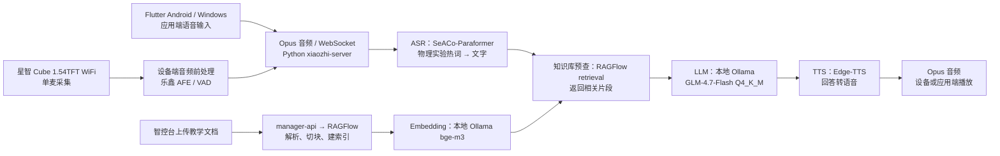

# 小智项目交接包

> 2026-10-11。本包集中提供项目本地保存的服务端、ESP32 固件与 Flutter 应用端源码；按各方向 README 阅读即可了解自己负责的环节。

## 当前系统怎样回答学生

项目使用**星智 Cube 1.54TFT WiFi 版（ESP32-S3）**作为实体语音设备，也有 Flutter Android/Windows 应用端。最近有运行证据的主模型是服务器本地 Ollama 中的 **GLM-4.7-Flash Q4_K_M**（服务名 `glm-4.7-flash-voice`）；语音识别使用 **FunASR SeACo-Paraformer** 和物理实验术语热词；知识库使用 **RAGFlow**，向量模型是本地 Ollama 的 **bge-m3**；语音播报使用 **Edge-TTS**。



知识库预查只在智能体已配置相应知识库功能时介入；检索到的片段供主模型生成回答。设备端降噪/AEC 的实际效果尚未经过课堂验收。图中模型和链路依据最近的项目记录与本地代码，**不代表 10-11 已重新确认服务器正在加载的模型、实机固件或知识库数据**；这些需取得服务器权限后核实。

## 阅读入口

| 文件 | 作用 |
| --- | --- |
| `README.md` | 总入口、目录结构与上游项目 |
| `README-ASR.md` | 现有语音识别流程、课堂噪声问题背景和 ASR 关键源码 |
| `README-RAG.md` | 智控台上传、RAGFlow 检索和回答生成流程及关键源码 |
| `README-硬件.md` | 当前板型、音频采集与上传流程及固件关键源码 |
| `智控台操作指南.md` | 校园网访问、登录、智能体、模型和知识库操作 |
| `服务器操作指南.md` | 使用 `devuser` 登录，查看目录、状态、日志、传输文件及更新代码；密码只在该指南开头填写 |
| `服务器现状记录.md` | 10-11已确认的账号、系统、磁盘、目录与Git检查，以及两端文件清单比较范围 |
| `代码版本记录.md` | 本地四个Git仓库已保存的完整SHA、服务器仓库状态与两端文件差异统计 |

先阅读智控台指南和自己方向的 README。服务器登录权限由负责人另行通知；在通知前，服务器指南用于了解目录和操作方式，密码栏暂留空。获得权限后再按服务器指南登录和查看线上代码、日志或运行环境。

## 代码目录

```text
交接包-小智项目/
├── README.md
├── README-ASR.md
├── README-RAG.md
├── README-硬件.md
├── 智控台操作指南.md
├── 服务器操作指南.md
├── 服务器现状记录.md
├── xiaozhi-esp32-server/
│   └── main/
│       ├── xiaozhi-server/     Python 核心：WebSocket、ASR、检索、回答与播报
│       ├── manager-api/       Java 管理后端：智能体、设备、模型与知识库
│       ├── manager-web/       Web 智控台
│       └── manager-mobile/    移动管理端
├── xiaozhi-esp32-main/         ESP32 固件工程
└── FlutterClient/
    ├── README.md              当前应用端版本、关键文件与目录选择说明
    └── active/source-code/    Flutter 应用端及各平台工程
```

## 上游项目

| 组件 | 上游项目 |
| --- | --- |
| 服务端与智控台 | [xinnan-tech/xiaozhi-esp32-server](https://github.com/xinnan-tech/xiaozhi-esp32-server) |
| ESP32 固件 | [78/xiaozhi-esp32](https://github.com/78/xiaozhi-esp32) |
| Flutter 应用端 | [TOM88812/xiaozhi-android-client](https://github.com/TOM88812/xiaozhi-android-client) |

本项目在这些上游工程基础上做过修改。上游链接用于了解基础架构，当前项目实现以本包源码和方向说明为准。
